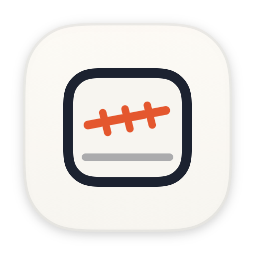
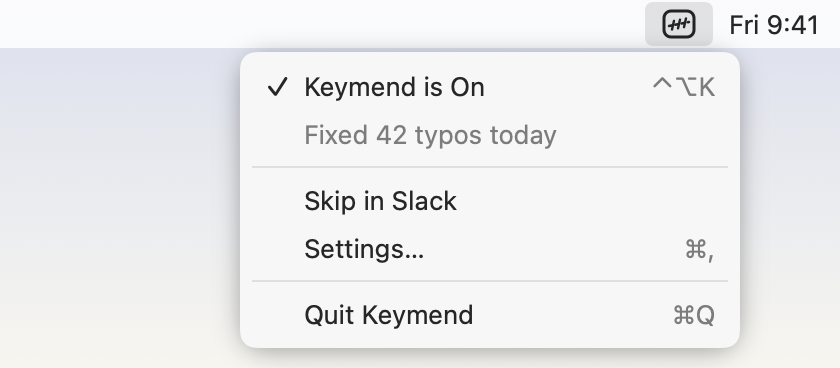
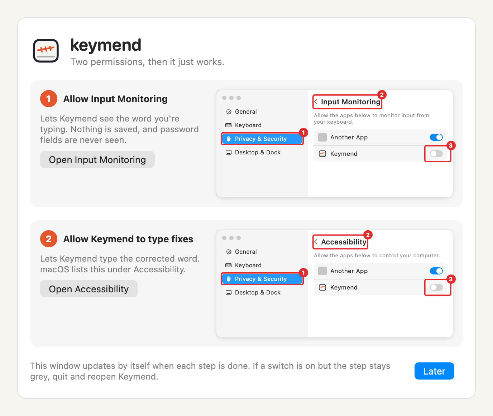

<p align="center"></p>

<h1 align="center">keymend</h1>

<p align="center">Spelling fixes as you type, in every Mac app.<br>
<a href="https://garoknows.github.io/keymend/">Website</a> · <a href="https://github.com/garoknows/keymend/releases/tag/v1.0.2">Download</a> · <a href="docs/PRIVACY.md">Privacy</a> · <a href="docs/INSTALL.md">Install guide</a></p>

Mac autocorrect only works in apps built with Apple's own text tools, like Notes, Mail and Messages. In Chrome, Arc, Dia, Slack, Obsidian, the Claude and ChatGPT desktop apps and other apps built on web technology, typos just get a red underline. No Mac setting changes that.

Keymend is a small menu bar app that fixes them as you type, in every app. It uses only Apple's built-in spell checker and never connects to the internet.

<p align="center"></p>

## What it does

- **Fixes a word when it ends.** After you type a space or `, ; ! ?`, the finished word is checked. If Apple's spell checker has a confident correction, Keymend swaps it in. `teh ` becomes `the `.
- **Instant undo.** Press Delete right after a fix to get your word back. Keymend then leaves that word alone until you quit it.
- **Pause anytime.** The switch in the menu, or Control-Option-K from anywhere.
- **Skips apps.** Off by default in most terminals, code editors, password managers and apps that already autocorrect (Terminal, iTerm, VS Code, Xcode, Cursor, Word, Notes, Mail, Pages, Messages, Safari and more). Add or remove apps in Settings, or with "Skip in [app]" in the menu.
- **Careful Mode for terminals.** On by default in Ghostty only. It fixes lines that look like plain language and leaves anything that looks like a command or code alone. It can't be perfect: read [Terminals and Careful Mode](#terminals-and-careful-mode).
- **Smart skips.** Never touches ALL CAPS, words with numbers, links, email addresses, file paths, @mentions, #tags, or anything inside `backticks`.
- **Your words.** A personal dictionary of words to never change. It starts empty and is shared with the Mac's own "Learn Spelling" list.
- **Today's count.** The menu shows how many typos it fixed today. It only counts; the count doesn't keep the words.
- **Learning Dictionary (optional, off until you turn it on).** Learns single words you often fix or undo. You review everything in Settings → Learning. [What it stores](#learning-dictionary).
- **Word suggestions (beta).** A small bar shows the word you're typing and up to three ways to finish it. Pick one with Option+number or a click. [How it works](#word-suggestions-beta).

Return and Tab end a word without fixing it, on purpose: in chat apps Return sends the message immediately, and a fix typed after that would land in the empty box.

## Install

Careful Mode and the Learning Dictionary are in the 1.1.0 pre-release, which hasn't had daily use yet. Keymend 1.0.2 is still the main download and doesn't have them. Word suggestions are only in the 1.2.0 beta.

1. Download [`Keymend-1.0.2.dmg`](https://github.com/garoknows/keymend/releases/tag/v1.0.2), or [`Keymend-1.1.0.dmg`](https://github.com/garoknows/keymend/releases/tag/v1.1.0) to try the pre-release, open it and drag **Keymend** into Applications.
2. Open Keymend. It's signed with a Developer ID and notarized by Apple, so it opens normally. ([Step-by-step guide](docs/INSTALL.md))
3. Keymend opens a setup window that shows exactly where to click for its two permissions.

<p align="center"></p>

Or build it yourself (needs Xcode):

```sh
git clone https://github.com/garoknows/keymend.git
cd keymend
scripts/install.sh
```

Apps you build yourself are signed ad hoc for your Mac only.

## Permissions

Keymend asks for exactly two, and nothing else:

| Permission | Where macOS lists it | Why |
| --- | --- | --- |
| Input Monitoring | Privacy & Security → Input Monitoring | To see the word you're typing |
| Post keyboard events | Privacy & Security → Accessibility | To type the corrected word |

No screen recording, contacts, location or network. Files are limited to what you pick yourself in a save or open dialog, to export or import learned words.

The word suggestions beta adds no permissions. It uses these same two to take the pick keys, Option+1, 2, 3 and 4 by default, [only while the bar is showing](#word-suggestions-beta).

## Privacy, in plain English

To fix typing, an app has to see your keys. That makes Keymend technically a keylogger, so these rules matter. Each one is enforced by macOS or checked automatically on every change ([details](docs/PRIVACY.md)):

1. **No internet, enforced by Apple.** Keymend runs in the App Sandbox with no network permission. macOS blocks any connection, even from a future bug.
2. **Nothing you type is saved, unless you turn on Learning.** Only the word you're typing right now is held in memory, and it's cleared when the word ends, when you switch apps, or click. No logs, analytics or crash reports. With Learning on, single words and counts are kept, encrypted, on this Mac ([exactly what](#learning-dictionary)).
3. **Password fields stop Keymend seeing keys.** They turn on macOS Secure Input, which stops Keymend from receiving keys. Keymend also checks for it and does nothing while it's on. **The exception is terminal password prompts.** They only use Secure Input if the terminal turns it on, so otherwise the keys reach Keymend's memory ([details](#passwords-in-terminals)).
4. **Only two permissions**, listed above.
5. **No third-party code.** Plain Swift and Apple frameworks. No analytics, no auto-updater.
6. **Open source.** Read it, or build it yourself.

`scripts/check-privacy.sh` checks the entitlements, the source and the built app for these rules. CI runs it on every push.

## Terminals and Careful Mode

Keymend only sees key presses. It can't read the screen or tell what's running in a terminal. So in Careful Mode a line stays off unless it looks like plain language, such as a message to a coding assistant.

**It leaves a line alone when:**

- Keymend hasn't seen it from its start. After you switch to the terminal, nothing is fixed until you press Return once.
- It starts with a known command (`cd`, `git`, `brew`, `sudo`, `python` and many more), or with `!`, `./`, `$` or a path.
- Its first word isn't a real word.
- It comes right after a command line, a trailing `\` or `<<`. The next line could be a password prompt or more of the same command.
- You pasted, clicked, pressed an arrow key, Tab, Escape or a Control or Command shortcut. The rest of that line stays off.
- It's inside a ` ``` ` code block.

**It stops at the first word that looks like code or that it doesn't recognize:** anything containing `/ \ . _ - = $ ~ @ : # *` or backticks (a full stop or comma at the end of a word is fine), flags, paths, links, emails, ALL CAPS, camelCase, digits, or a misspelled word with no confident fix.

**It never fixes:**

- Words in quotes.
- A misspelled word before two correctly spelled words have appeared on the line.
- The last word when you press Return. Keymend never presses Return, so a fix can't run a command by itself, but it can change one you then run.

To turn it off fast, use "Skip in [app]" in the menu, or Control-Option-K to pause everywhere.

### Known gaps

**Careful Mode can't promise that commands are never changed.** A command Keymend has never heard of, with plain words after it, looks exactly like a sentence. These can still change:

```
deploy the staging servr
install the latest packge
restart the main sevice
```

Other limits:

- Lines inside a multi-line command, after the first, and lines typed into a program's own prompt (a database shell, for example) can look like prose.
- Programs where keys are commands, like vim or less, may receive a Delete or a letter if what you type there looks like a sentence.
- Keys posted by text expanders and similar tools are detected only if they don't present themselves as a real keyboard.
- Fixes are limited on purpose. Expect fewer fixes than in other apps.

The tests in `CarefulModeTests.swift` type more than 100 made-up commands, paths, code lines and prose lines key by key, with a stand-in spell checker that wants to change every word it doesn't know. They include a known-gaps test that lists lines which still change, so the limit stays visible.

### Passwords in terminals

A terminal password prompt (`sudo`, `ssh`) doesn't have to use Secure Input. If it doesn't, the keys reach Keymend's memory like any others. Keymend writes nothing down, but it holds the current word in memory while you type it, and a passphrase with spaces could be "fixed", which would make the login fail.

That's why Careful Mode is on by default only in Ghostty, which turns on Secure Input when it detects a password prompt. Ghostty's detection is a best guess and doesn't work over SSH. Keep it on by adding this line to your Ghostty config (it's on by default):

```
macos-auto-secure-input = true
```

Terminal, iTerm and other terminals stay skipped unless you change that, and Keymend warns you first. Turning on Secure Keyboard Entry in a terminal protects its password prompts, and it also stops Keymend working in that terminal.

## Learning Dictionary

**Off until you turn it on,** in Settings → Learning.

| It notices | When | What happens |
| --- | --- | --- |
| A correction: you delete back and retype a flagged word, with at most 2 letters different | Within 5 seconds, 3 times on at least 2 different days | Proposed as a rule. **Nothing changes until you approve it** |
| An undo: you press Delete right after a fix | 2 times | That fix stops, automatically |
| A word the spell checker flags, has no confident fix for, and you don't go back to | 5 times on at least 3 different days | Treated as known, automatically |

Anything that makes Keymend do less applies by itself. Anything that makes it type something new needs your approval. In Settings → Learning you can review, approve, edit, reject, delete, search, pause, clear everything, and export or import.

**Stored for each item, and nothing else:** the kind, the typed word, the correction, a count, the number of days it was seen, the last day it was seen (no time), and its status.

**Never stored:** sentences, neighbouring words, the app, window, document or website, the time of day, or anything from a password field or an excluded app.

**It doesn't learn from:**

- Anything that looks like code, a path, an email or a handle. You can add emails and handles by hand.
- Words in quotes or backticks.
- Terminals or other Careful Mode apps. What it learned isn't used there either.
- Apps on the exclusion list. The default lists password managers only. **Add your banking apps yourself in Settings → Learning → Excluded Apps.**

**Where it lives:** one file in Keymend's sandbox container, encrypted with AES-256-GCM. The key is in your login Keychain. Words not approved or made active are forgotten after 90 days unseen. Learned words stay out of the Mac's shared Learn Spelling list. An export is a separate file encrypted with a passphrase you choose.

**What changes when it's on:**

- To catch a correction, Keymend keeps the last finished word in memory for about 5 seconds. With Learning off, it's cleared the moment the word ends.
- Keymend writes that one encrypted file.

**What it can't do:**

- Encryption protects the file if it's copied, or read from a backup or a stolen disk. It doesn't protect against malware running as you while your Mac is unlocked, and the list is in memory while Keymend runs.
- Keymend can't tell which website you're on, so a bank's website isn't excluded. Only its password fields are, through Secure Input.
- A letters-only password typed into an ordinary field that doesn't use Secure Input could be recorded, if you mistype and retype it or type it often enough. It would be encrypted and visible in your review list, where you can delete it.
- The list will include people's and clients' names, as single words. That's why it's encrypted and reviewable.

## Word suggestions (beta)

While you type a word, after two letters, a small bar shows the word as you typed it, in quotes, and up to three ways to finish it from Apple's on-device spell checker. Each has a number.

- **Pick a completion** with Option+2, 3 or 4, or a click. Keymend types the word and a space.
- **Pick the quoted word** with Option+1 or a click. It stays as you typed it, and Keymend won't autocorrect that word until you quit.
- **The bar goes away** on space, punctuation, Return, Tab, Esc, a click elsewhere or switching apps. It never shows in skipped apps, Careful Mode apps like Ghostty, password fields, or Keymend's own windows. Turn it off in Settings → General.

**Keymend can stop these keys reaching your app, but only while the bar is showing.** At all other times it only watches keys and can't stop or change them. While the bar is up, a second part of Keymend, an active event tap, checks each key press and blocks a pick key from reaching your app, so Option+1 doesn't also type ¡. It blocks only pick keys for a choice the bar is showing, along with that key's repeat and release. Every other key goes straight through, unchanged. That tap is removed as soon as the bar goes away.

**Option plus a number types something on some keyboards**, like # on British, @ on Portuguese and { on Italian. If you need one of those, choose different keys in Settings → General → Suggestions.

**The bar sits at the bottom center of the front window, not at your cursor.** Reading the cursor's position would need more access to other apps than the App Sandbox allows. Keymend reads only the front window's position and size, never its title or contents. If it can't get those, the bar sits at the bottom center of the screen.

**What it keeps:** nothing new on disk. The word and its completions are in memory only while the bar shows, and the bar shows them on screen, where they'd appear in a screen share. The checks use Apple's spell checker on this Mac, with no network.

### Known issues in the suggestions beta

- **Turning off a permission while the bar is up could freeze your Mac's input.** One developer [reports](https://developer.apple.com/forums/thread/844416) that turning off Accessibility while an active tap is running froze all keyboard and mouse input until a forced restart. Apple hasn't given a fix. Keymend stops its tap if either permission is lost: clicking anywhere, including on the switch in System Settings, hides the bar and removes the tap, macOS's notice of an Accessibility change stops it at once, and Keymend re-checks both permissions 4 times a second while it runs. That leaves a very short window, and a change made without a click, such as by a management tool, could still land in it. The tests use a stand-in for the tap, so this hasn't been tried on a real Mac. If input ever freezes, hold the power button to restart, and please [open an issue](https://github.com/garoknows/keymend/issues).
- **Not yet proven on a real Mac:** that macOS lets a sandboxed app's tap block keys, that the bar's clicks leave focus in your app, and that its position is right. If macOS refuses the tap, the pick keys type as usual, Settings says so, and clicking still works.
- **Picking waits briefly for you to let go of Option,** up to 0.4 seconds, so Option can't change what Keymend types. A key pressed during that wait cancels the pick.
- **A completion can land wrongly if a key arrives in the instant it's being typed,** the same limit as fixes.

## How it works

Keymend watches key presses with an event tap that can't stop or change them. (The suggestions beta adds [a second one that can](#word-suggestions-beta), only while its bar is showing.) When a word ends, it asks `NSSpellChecker` (the same on-device engine as Mac autocorrect) for a correction, giving up after 50 ms. If there is one, it presses Delete once per character of the word and the punctuation after it, then types the correction. If you've already pressed another key by then, it drops the fix. That covers most fast typing, but a key pressed in the instant the fix is being typed can still land in the middle of it, so a word can occasionally come out garbled. If you see that, please [open an issue](https://github.com/garoknows/keymend/issues).

If Keymend can't be sure where the cursor is (after a click, an arrow key, a shortcut or switching apps), it leaves the next word alone.

## Build and test

```sh
swift test --package-path Packages/KeymendCore   # word engine and keyboard harness tests
scripts/check-privacy.sh                         # privacy rules
brew install xcodegen && xcodegen generate       # Xcode project from project.yml
```

The word engine and keyboard bridge live in `Packages/KeymendCore` with no UI. The harness tests feed real `CGEvent`s through the bridge into a simulated text field and check exactly what text arrives, including typing at 400 words per minute. That field applies each fix as one unit, so these tests don't catch a key landing in the middle of a fix.

## Known limits (v1.0)

- English-focused: it follows the Mac's current spell-checker language. More languages are planned for 1.1.
- Accented letters typed with dead keys (Option-E, then E) end tracking for that word.
- Input methods for Chinese, Japanese and Korean aren't supported.
- Coming in 1.1: your Mac's Text Replacements in every app, capitalize sentences, double-space period, Homebrew.

## License

MIT. See [LICENSE](LICENSE). Not affiliated with Apple.
