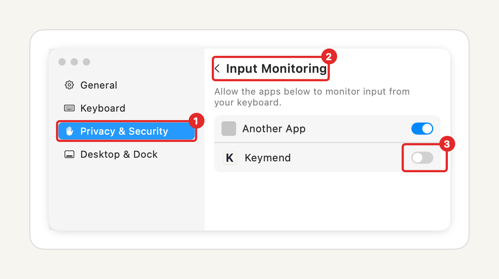
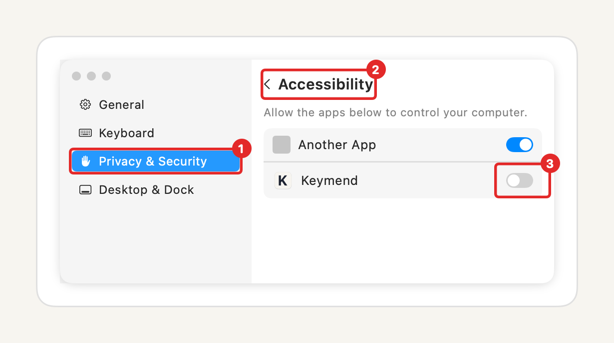

# Installing Keymend

Keymend needs macOS 14 Sonoma or later.

## 1. Download and copy

1. Download [`Keymend-1.1.1.dmg`](https://github.com/garoknows/keymend/releases/download/v1.1.1/Keymend-1.1.1.dmg) from [GitHub Releases](https://github.com/garoknows/keymend/releases/tag/v1.1.1).
2. Open it and drag **Keymend** onto the **Applications** folder.

## 2. Open it

Double-click **Keymend** in Applications. It's signed with a Developer ID and notarized by Apple, so it opens normally. macOS may ask once to confirm that you want to open an app downloaded from the internet; click **Open**.

## 3. Allow the two permissions

Keymend opens its setup window. Each step turns green by itself when it's done.

**Step 1: Input Monitoring.** Click **Open Input Monitoring**, then turn on the switch next to Keymend.

**Step 2: Typing fixes.** Click **Open Accessibility**, then turn on the switch next to Keymend.

If a switch is on but the step stays grey, quit Keymend from its menu and open it again. macOS sometimes applies Input Monitoring only after a restart of the app.

If the menu ever says "Not working: macOS stopped Keymend's keyboard access", click **Try Again**. Keymend also retries by itself every 30 seconds.

## 4. Use it

Look for the bold K in your menu bar. Type as usual. The menu shows how many typos Keymend fixed today, a switch to pause it (or press Control-Option-K), and "Skip in [app]" for the app you're in.

Open **Settings** to turn on launch at login, edit the list of apps Keymend stays off in, and add words it should never change.

## Uninstall

1. Choose **Quit Keymend** from its menu.
2. Drag **Keymend** from Applications to the Trash.
3. Optional: remove its settings folder, `~/Library/Containers/io.github.garoknows.keymend`, and turn off its entries in System Settings → Privacy & Security.
